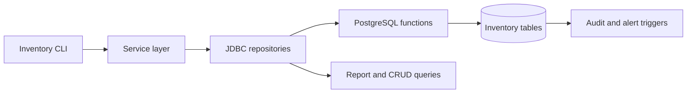

# Intelligent Inventory Management System

A Java and PostgreSQL warehouse inventory application built to explore a deceptively difficult question: how does a multi-user system keep stock correct when people act at the same time?

I built this as a student portfolio project around the parts of inventory software that are easy to get wrong: atomic updates, overselling, partial transfers, auditability, and useful operational alerts. The interface is intentionally a small command-line application so the design stays focused on database behavior and testable business rules.

## What it does

- Manages active and inactive products with unique SKUs.
- Models users with `ADMIN`, `MANAGER`, and `EMPLOYEE` roles.
- Receives, sells, transfers, and manually adjusts stock.
- Records physical counts without silently changing system quantity.
- Prevents negative inventory and lost updates.
- Creates and resolves low-stock and discrepancy alerts.
- Keeps stock-transaction and inventory-audit histories.
- Creates purchase orders, adds draft lines, and guards status transitions.
- Reports current inventory, low stock, recent movements, discrepancies, alerts, and audits.

## Technology

- Java 17
- Maven 3.9+
- JDBC with prepared statements
- PostgreSQL 14+ (Docker Compose uses PostgreSQL 16)
- JUnit 5
- Embedded PostgreSQL for default local integration tests
- GitHub Actions with a PostgreSQL service

## Architecture



The responsibilities are deliberately separated:

- `controller` parses commands and formats output.
- `service` validates input and checks application permissions.
- `repository` owns parameterized SQL and JDBC transaction boundaries.
- `model` contains domain records and enums.
- `database` defines tables, constraints, functions, triggers, and demo seed data.

See [Architecture](docs/architecture.md) and [Database design](docs/database-design.md) for the detailed decisions and ER diagram.

## Database design

The main inventory key is `(product_id, warehouse_id)`, so the same product can have an independent quantity at each location. Check, foreign-key, unique, and not-null constraints provide a final safety net even if a caller bypasses the Java services.

Core tables:

- `app_user`
- `category`
- `supplier`
- `warehouse`
- `product`
- `inventory`
- `stock_transaction`
- `purchase_order` and `purchase_order_line`
- `inventory_count`
- `inventory_alert`
- `audit_log`

Products and users are deactivated rather than deleted so historical foreign keys remain meaningful.

## Transactions and concurrency

Each stock-changing JDBC method disables auto-commit, uses PostgreSQL's `READ COMMITTED` isolation level, calls one transaction function, and then explicitly commits or rolls back.

For a sale, `process_stock_sale`:

1. Locks the product/location row with `SELECT ... FOR UPDATE`.
2. Checks the now-current available quantity.
3. Updates inventory.
4. Inserts the movement record.
5. Returns the new quantity.

Those steps share one transaction. If any step fails, none of them remain committed.

Transfers lock both warehouses in ascending warehouse-ID order. That stable order prevents two opposite-direction transfers from each holding one lock while waiting forever for the other.

Purchase-order status updates use a different technique: the `UPDATE` includes the expected current status. If another user changed it first, zero rows update and the caller must refresh rather than overwrite the newer state.

The concurrency integration test starts with 10 units and releases two real database connections together. One tries to sell 7 and the other 6. It verifies that exactly one commits, the other rolls back, one sale ledger row exists, and final stock matches the winner. See [Concurrency](docs/concurrency.md).

## Triggers and stored functions

### Triggers

- `trg_inventory_audit` stores old quantity, new quantity, change, time, and application actor after a real quantity update.
- `trg_low_stock_alert` creates or refreshes one unresolved low-stock alert per product/location and resolves it after recovery.
- `trg_discrepancy_alert` compares a physical count with the expected quantity and raises an alert when the configured threshold is exceeded.

### Transaction functions

- `receive_inventory`
- `process_stock_sale`
- `transfer_inventory`
- `perform_inventory_adjustment`
- `reconcile_inventory_count`

The functions contain short sequences where locking and all-or-nothing behavior matter. Search and reporting remain ordinary SQL in repositories because moving every query into a stored function would add complexity without improving consistency.

## Roles

| Capability | Admin | Manager | Employee |
| --- | --- | --- | --- |
| View inventory and history | Yes | Yes | Yes |
| Receive and sell stock | Yes | Yes | Yes |
| Transfer or adjust stock | Yes | Yes | No |
| Record physical counts | Yes | Yes | No |
| Manage purchase orders | Yes | Yes | No |
| Resolve alerts | Yes | Yes | No |
| Manage products and users | Yes | No | No |

The CLI accepts a seeded username to identify the actor for a demo command. This demonstrates authorization and audit propagation, but it is not authentication. A production system would add password or identity-provider login and server-managed sessions.

## Project structure

```text
database/                         schema, functions, triggers, seed data
docs/                             architecture and concurrency notes
src/main/java/.../config/         database configuration and connections
src/main/java/.../controller/     CLI argument handling
src/main/java/.../model/          domain records and enums
src/main/java/.../repository/     JDBC and SQL
src/main/java/.../service/        permissions and use cases
src/test/java/                    unit and PostgreSQL integration tests
docker-compose.yml                reproducible local PostgreSQL
```

## Local setup

### Prerequisites

- JDK 17 or newer
- Maven 3.9 or newer
- Docker Desktop, or another PostgreSQL 14+ server

Check them with:

```powershell
java -version
javac -version
mvn -version
docker --version
```

On a Windows installation where Maven comes with Apache NetBeans but is not on `PATH`, use:

```powershell
& 'C:\Program Files\Apache NetBeans\java\maven\bin\mvn.cmd' -version
```

### Start PostgreSQL

```powershell
docker compose up -d
docker compose ps
```

The first startup runs the numbered SQL files in `database/` and loads a small demo dataset. PostgreSQL initialization scripts only run for a new data volume.

To deliberately discard the local database and rebuild it from the SQL files:

```powershell
docker compose down -v
docker compose up -d
```

`down -v` permanently removes this Compose project's local database volume, so do not use it when the data matters.

### Configure the application

Copy `.env.example` to `.env` for Docker Compose. The Java process reads environment variables directly:

```powershell
$env:INVENTORY_DB_URL = 'jdbc:postgresql://localhost:5432/inventory'
$env:INVENTORY_DB_USER = 'inventory_app'
$env:INVENTORY_DB_PASSWORD = 'local_inventory_password'
```

`.env` is ignored by Git. Do not commit real passwords.

## Run the application

Show help:

```powershell
mvn exec:java -Dexec.args="help"
```

List current inventory and low stock:

```powershell
mvn exec:java -Dexec.args="employee.demo inventory"
mvn exec:java -Dexec.args="employee.demo low-stock"
```

Record a sale and inspect its history on a fresh seed database:

```powershell
mvn exec:java -Dexec.args="employee.demo sell 1 1 3 SALE-DEMO-001"
mvn exec:java -Dexec.args="employee.demo transactions 1 20"
```

Manager workflows:

```powershell
mvn exec:java -Dexec.args="manager.demo transfer 1 1 2 4 MOVE-DEMO-001"
mvn exec:java -Dexec.args="manager.demo count 1 1 20 Cycle count"
mvn exec:java -Dexec.args="manager.demo alerts"
mvn exec:java -Dexec.args="manager.demo discrepancies 20"
```

Administrator workflows:

```powershell
mvn exec:java -Dexec.args="admin.demo add-product STAND-01 LaptopStand 29.95 4 1"
mvn exec:java -Dexec.args="admin.demo create-user receiver.demo Receiver EMPLOYEE -"
mvn exec:java -Dexec.args="admin.demo users all"
```

Run `mvn exec:java -Dexec.args="help"` for every supported command and argument shape. Numeric IDs are shown by the inventory, product, user, and purchase-order list commands.

## Tests

Run all tests with an embedded PostgreSQL instance:

```powershell
mvn test
```

To run them against Docker, first create a dedicated disposable test database:

```powershell
docker compose exec postgres createdb -U inventory_app inventory_test
mvn "-Dtest.database.url=jdbc:postgresql://localhost:5432/inventory_test" `
    "-Dtest.database.user=inventory_app" `
    "-Dtest.database.password=local_inventory_password" test
```

External integration tests drop and recreate the `public` schema. As a safety check, the test harness refuses database names that do not contain `test`. Never point it at a database that contains data you want to keep.

The suite covers:

- domain input validation;
- product and user repositories;
- unique SKU behavior;
- schema objects and seed data;
- non-negative inventory constraints;
- successful and failed transfers;
- rollback behavior;
- simultaneous sales through separate connections;
- low-stock alert deduplication and automatic resolution;
- discrepancy alerts and actor-aware audit entries;
- role permissions;
- report queries;
- purchase-order state changes.

GitHub Actions runs the suite against a clean PostgreSQL 16 service on pushes and pull requests.

## Security and privacy notes

- SQL values use prepared-statement parameters.
- Secrets come from environment variables, and `.env` is ignored.
- PostgreSQL constraints defend critical invariants if Java validation is bypassed.
- The demo stores no customer data and collects no analytics.
- The actor selector is not authentication; do not expose this prototype directly to the internet.
- A production database account should receive only the required table/function privileges instead of broad schema ownership.

## Lessons learned

- Lock the row that contains the decision-making value, not just the row eventually written.
- A database constraint is a useful final guard, but it does not replace a clear service error.
- Transfers need a consistent lock order as well as a transaction.
- Audit context can cross the JDBC/PostgreSQL boundary with a transaction-local setting.
- Test data must account for trigger side effects; the seed process legitimately creates its own low-stock alert.
- Optimistic and pessimistic concurrency controls solve different problems and can coexist in one system.

## Limitations and future improvements

- Add real authentication and securely hashed credentials.
- Introduce database migration version tracking for upgrades to existing installations.
- Link purchase-order receiving directly to received line quantities.
- Add barcode scanning and a web interface without moving business rules into UI code.
- Add configurable per-role permissions and least-privilege PostgreSQL grants.
- Add pagination for large histories and reports.
- Measure query plans with realistic data volumes before adding more indexes.

No production usage, external users, performance metrics, or field-study results are claimed for this project.
