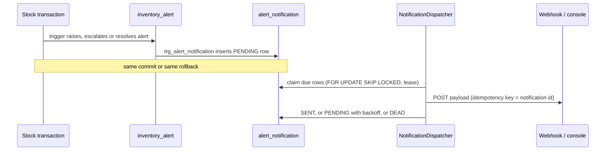

# Alert notifications

Low-stock and discrepancy alerts are only useful if someone hears about them. This
document explains how alert changes become outbound notifications without losing
events, sending events for changes that rolled back, or delivering the same event
twice from two workers.

## Design: transactional outbox



Sending an HTTP request from inside a database trigger would hold row locks during a
network call and could not be rolled back. Instead, `trg_alert_notification` writes a
row to `alert_notification` inside the same transaction that changed the alert. If the
sale, transfer, or threshold change rolls back, the notification disappears with it.

A separate dispatcher delivers rows after commit. Delivery is **at-least-once**: if a
worker crashes after the webhook accepted a request but before recording `SENT`, the lease
expires and another worker retries it. Receivers should de-duplicate with the
`X-Inventory-Notification-Id` header, which never changes across retries.

## Which events are sent

| Event | When |
| --- | --- |
| `RAISED` | A new alert row is inserted (low stock or discrepancy). |
| `ESCALATED` | An open alert's severity rises to `CRITICAL`, for example stock reaching 0. |
| `RESOLVED` | An alert is resolved, either automatically after recovery or by a manager. |

The low-stock trigger refreshes an open alert on every sale below the threshold. Those
refreshes do **not** produce notifications unless severity escalates, so a busy product
sends one message instead of one per sale.

## Configurable thresholds

- Each product has a default `reorder_threshold`.
- Each product/warehouse location may override it with `inventory.low_stock_threshold`.
  `NULL` means "use the product default".
- `set_low_stock_threshold` locks the location row, writes an `inventory_threshold` audit
  entry with the acting user, and re-evaluates the alert in the same transaction. Raising
  a threshold above current stock raises an alert immediately; clearing it can resolve one.
- Changing a product's default re-evaluates every location without an override.

```powershell
mvn exec:java -Dexec.args="manager.demo set-threshold 1 1 30"
mvn exec:java -Dexec.args="manager.demo set-threshold 1 1 default"
```

Only `ADMIN` and `MANAGER` users hold the `CONFIGURE_ALERTS` permission.

## Dispatching

```powershell
# One pass, suitable for cron or a scheduled task
mvn exec:java -Dexec.args="manager.demo dispatch-notifications 50"

# Long-running worker: polls every 15 seconds until stopped with Ctrl+C
mvn exec:java -Dexec.args="manager.demo notification-worker 15 50"

# Inspect and recover
mvn exec:java -Dexec.args="manager.demo notifications dead"
mvn exec:java -Dexec.args="manager.demo requeue-notification 12"
```

Several workers may run at once. Each claim:

1. selects due `PENDING` rows whose lease is absent or expired, in due order;
2. locks them with `FOR UPDATE SKIP LOCKED`, so concurrent workers take disjoint rows;
3. stores a fresh `claim_token` and `locked_until`, and counts the attempt.

Recording the outcome requires the same `claim_token`. A slow worker whose lease expired
cannot overwrite the result of the worker that reclaimed the row; it reports the row as
`lost-lease`.

### Retry policy

Failed attempts are retried with exponential backoff: 30 s, 1 min, 2 min, ... capped at
1 hour. After 6 attempts the row becomes `DEAD` and keeps its `last_error`. A manager can
requeue it after fixing the receiver, which resets the attempt budget.

## Channels

Without configuration, notifications print to standard output, which is useful for demos.
Set these environment variables to deliver to an HTTP endpoint instead:

| Variable | Purpose |
| --- | --- |
| `INVENTORY_ALERT_WEBHOOK_URL` | `http` or `https` endpoint that receives `POST` JSON. |
| `INVENTORY_ALERT_WEBHOOK_SECRET` | Optional. Adds `X-Inventory-Signature: sha256=<HMAC of body>`. |
| `INVENTORY_ALERT_WEBHOOK_TIMEOUT_SECONDS` | Optional connect/request timeout. Default 10. |

Any non-2xx response, timeout, or I/O error counts as a failed attempt. Log output names the
endpoint's host and path but never its query string, which often carries a token.

Example payload:

```json
{
  "event": "RAISED",
  "alertId": 2,
  "alertType": "LOW_STOCK",
  "severity": "WARNING",
  "productId": 1,
  "sku": "USB-C-2M",
  "productName": "USB-C Cable 2m",
  "warehouseId": 1,
  "warehouseCode": "CHI-01",
  "message": "USB-C Cable 2m has 25 units; reorder threshold is 30",
  "expectedQuantity": 30,
  "actualQuantity": 25,
  "resolutionNote": null,
  "occurredAt": "2026-11-24T03:37:10.283128+00:00"
}
```

## Upgrade an existing database

Back up the database, then run the version-tracked runner, which applies
`006_alert_notifications.sql` once and records it:

```powershell
mvn -q compile exec:java "-Dexec.args=migrate"
```

The migration adds one nullable column, one table and its triggers, and queues one `RAISED`
notification for each alert that is already open, so existing problems are not silently skipped.

## Evidence

`AlertNotificationIntegrationTest` runs against real PostgreSQL and covers:

- the RAISED → ESCALATED → RESOLVED lifecycle with no duplicates for repeated low sales;
- a rolled-back sale leaving no alert and no notification;
- threshold overrides that are audited, re-evaluated immediately, and validated;
- product-default changes re-evaluating locations;
- delivery, backoff, dead-lettering and requeue;
- four concurrent dispatchers delivering 80 notifications exactly once each;
- a stale lease being unable to overwrite a newer claim;
- backfill of already-open alerts by the migration.

`WebhookNotificationChannelTest` uses an in-process HTTP server to check the body, headers,
HMAC signature, non-2xx and connection failures, and URL handling.

These tests demonstrate correctness of the mechanism. No delivery-rate or latency numbers
are claimed.
