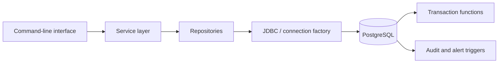

# Architecture

## Design goals

The application separates command-line interaction, business permissions, JDBC access, and PostgreSQL transaction rules. This keeps UI code small and makes the important behavior testable without pretending the UI is responsible for consistency.

## Layers

- `config`: reads database settings and creates connections.
- `model`: small Java records and enums representing domain data.
- `repository`: parameterized SQL for queries and ordinary CRUD operations.
- `service`: permission checks and use-case coordination.
- `controller`: command-line request handling and output formatting.
- `exception`: domain-specific failures that callers can handle clearly.
- `migration`: version-tracked runner that applies the numbered SQL files.
- `security`: password hashing, login, lockout, and sessions.
- `notification`: alert-notification dispatcher, retry policy, and delivery channels.
- `database`: schema, stored functions, triggers, and seed data.

## Transaction boundary

Stock-changing operations call PostgreSQL functions through JDBC. The database function owns the transaction-critical sequence: lock the inventory row, validate the quantity, update inventory, and record the stock transaction. The Java service owns authorization and translates database failures into application errors.

This division provides defense in depth. A service check gives a clear error to a user, while database constraints remain the final protection against invalid state.

## Permission model

| Capability | Admin | Manager | Employee |
| --- | --- | --- | --- |
| Manage users and products | Yes | No | No |
| Receive and sell stock | Yes | Yes | Yes |
| Transfer or manually adjust stock | Yes | Yes | No |
| Manage purchase orders | Yes | Yes | No |
| View inventory and history | Yes | Yes | Yes |
| Resolve alerts | Yes | Yes | No |

Application roles are intentionally separate from PostgreSQL login roles. The CLI connects with one database account and checks the signed-in user's role in the service layer. The supplied Compose account owns the database; least-privilege grants are still future work.

## Scope choices

The initial interface is a command-line application so effort stays focused on transactions, database behavior, and tests. Users sign in with passwords and server-side sessions (see [Authentication](authentication.md)); single sign-on, MFA and a graphical interface are out of scope.
