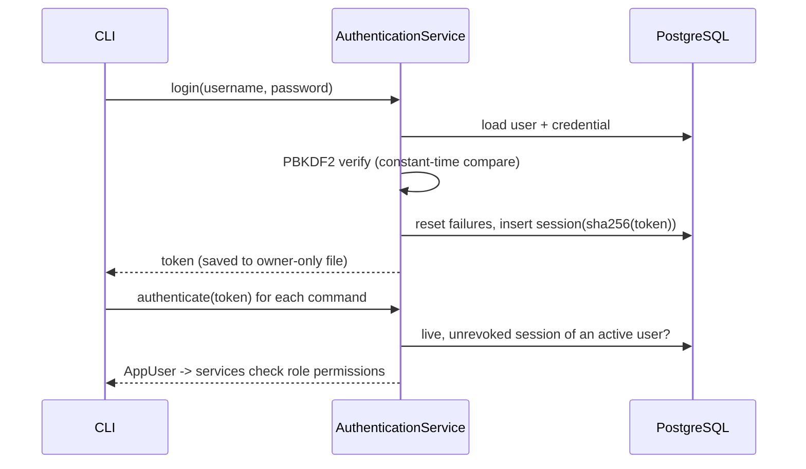

# Authentication

Every inventory change is attributed to a user, so the system has to know who that user
really is. This document describes how sign-in works and why.

## Flow

## Passwords

- PBKDF2-HMAC-SHA256 from the JDK, 600,000 iterations, 16-byte random salt, 256-bit output.
  No extra dependency is needed.
- Stored as `pbkdf2-sha256$<iterations>$<salt>$<hash>`. Verification uses the stored iteration
  count, so the default can be raised later without invalidating existing passwords.
- Policy: 12 to 128 characters, not blank. Length beats composition rules.
- Passwords are read from the terminal without echo, or from piped standard input. They are
  never accepted as arguments or environment variables, which leak through shell history and
  process listings. Password buffers are zeroed after use.

## Failed logins and lockout

- Unknown user, user without a password, inactive user, locked account and wrong password all
  return the same message: `Invalid username or password`.
- For unknown users and locked accounts the service still runs a full PBKDF2 derivation, so
  response time does not reveal which usernames exist.
- Failures are counted with one atomic `UPDATE`. The fifth consecutive failure locks the
  account for 15 minutes, during which even the correct password is refused. A success resets
  the counter.

## Sessions

- A session token is 32 random bytes (base64url). The client keeps it; the database keeps only
  its SHA-256 digest, so a copy of `user_session` cannot be replayed.
- Sessions expire after 8 hours and can be revoked with `logout`.
- Changing a password revokes all of that user's sessions in the same transaction.
- Deactivating a user invalidates their sessions immediately, because each lookup also requires
  `app_user.active`.
- The CLI stores the token in `~/.inventory/session` with POSIX `0600` permissions.

## Bootstrap

`bootstrap-admin <username>` sets the first password on a fresh installation. It takes an
`EXCLUSIVE` lock on `user_credential` and succeeds only if no credential exists, so two
simultaneous attempts cannot both succeed and it cannot be used later to take over an account.
After that, administrators set other users' passwords with `set-password`, and users change
their own.

## Auditing

Bootstrap and every password change write an `audit_log` row (`entity_type = 'user_credential'`)
with the acting user. Hashes are never written to the audit log.

## Demo mode

`INVENTORY_DEMO_MODE=true` keeps the original "`<username> <command>`" form so a reviewer can
try all three roles quickly. It deliberately skips passwords and must stay off outside a local
demo.

## Evidence

`AuthenticationIntegrationTest` (real PostgreSQL) covers bootstrap rules, two concurrent bootstrap
attempts with exactly one winner, raw tokens and passwords never stored, indistinguishable failures,
lockout and unlock, expiry, logout, deactivation, forged tokens, password-change authorization,
session revocation on password change, audit rows, and the CLI login/logout round trip.
`PasswordHasherTest` and `SessionStoreTest` cover hashing, salts, work-factor changes, malformed
values, policy, and file permissions.

## Out of scope

Multi-factor authentication, single sign-on, password reset by email, and rate limiting by
network address. Those belong with a network-facing API, which this CLI is not.
