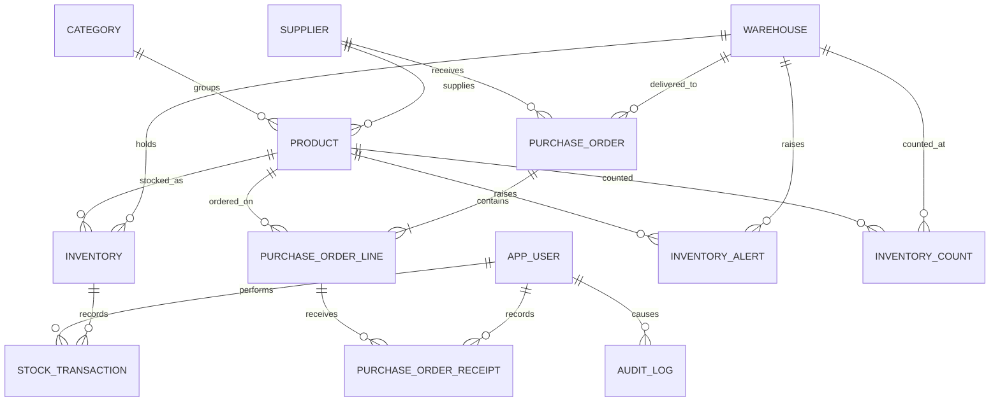

# Database Design

## Core invariants

1. A product SKU is unique and stable.
2. One inventory row exists per product and warehouse pair.
3. Inventory quantity can never be negative.
4. Every stock change has an actor and a matching stock-transaction record.
5. A transfer either changes both warehouses and records both movements, or changes neither.
6. At most one unresolved low-stock alert exists per product and warehouse.
7. Audit history is append-only from the application's point of view.

These invariants are enforced close to the data because every client, including future interfaces, must follow them.

## Entity relationships

## Tables

### `app_user`

Stores a unique username, display name, role (`ADMIN`, `MANAGER`, or `EMPLOYEE`), and active flag. It represents application actors, not PostgreSQL login accounts.

### `category`, `supplier`, and `product`

Products have a unique SKU, optional category and supplier, a non-negative reorder threshold and discrepancy threshold, and an active flag. Deactivation preserves references from historical records.

### `warehouse` and `inventory`

The composite primary key `(product_id, warehouse_id)` prevents duplicate stock rows. A check constraint prevents negative quantity even if application code is bypassed.

### `stock_transaction`

An append-only movement ledger. `quantity_change` is signed, while `quantity_before` and `quantity_after` make individual operations easy to explain and audit. Transfers share a correlation identifier.

### `purchase_order` and `purchase_order_line`

Purchase orders track expected inbound stock. `receive_purchase_order_line` commits
received line quantities, derived order status, stock, ledger, audit, alerts and a
`purchase_order_receipt` retry record in one transaction. Receipt keys are unique per
order. See [receiving design](purchase-order-receipts.md) for guarantees and upgrade steps.

### `inventory_alert`

Stores low-stock and discrepancy alerts. A partial unique index will prevent duplicate unresolved low-stock alerts for the same product and warehouse.

Low-stock evaluation uses `inventory.low_stock_threshold` when a location override is set and
the product's `reorder_threshold` otherwise.

### `user_credential` and `user_session`

`user_credential` holds one PBKDF2 hash per user plus the consecutive-failure counter and lock
expiry; a check constraint rejects anything that is not a `pbkdf2-sha256$` value. `user_session`
stores the SHA-256 digest of each bearer token with expiry and revocation times, and a partial index
on active sessions per user serves "sign out everywhere" after a password change.

### `schema_migration`

Written only by the migration runner. One row per applied file: version, description, SHA-256
checksum, who applied it, when, duration, and whether it was recorded by `baseline` rather than
executed. Comparing checksums on every run detects edits to files that were already applied.

### `alert_notification`

A transactional outbox of alert events (`RAISED`, `ESCALATED`, `RESOLVED`) written by a trigger in
the same transaction as the alert change. Dispatchers lease rows with `FOR UPDATE SKIP LOCKED` and
a `claim_token`; a partial index on `(next_attempt_at, id) WHERE status = 'PENDING'` keeps the
claim query to undelivered rows. See [Alert notifications](alert-notifications.md).

### `inventory_count`

Captures the expected quantity at count time and the independently observed physical quantity. Keeping both values makes discrepancies reproducible after inventory changes later.

### `audit_log`

Stores old and new row snapshots as `jsonb`, the responsible application user when known, and a timestamp. Inventory updates are captured by a trigger rather than relying on each caller to remember auditing.

## Index strategy

- Unique B-tree indexes support usernames, SKUs, supplier names, and warehouse codes.
- Inventory's composite primary key supports row locking and point lookups.
- Time-descending indexes support recent transaction, alert, and audit reports.
- Product and warehouse foreign-key indexes support history filtering.
- A partial unique index enforces one unresolved low-stock alert.
- A partial index on pending notifications serves the dispatcher's due-order claim query.

Indexes are added for demonstrated query patterns rather than every column; extra indexes slow down writes and consume storage.

## Concurrency strategy

PostgreSQL row locks serialize changes to the same inventory row without blocking unrelated products. A sale function uses `SELECT ... FOR UPDATE`, verifies available stock, then updates and records the movement in the same transaction. Transfers lock both inventory rows in deterministic warehouse-ID order so opposite-direction transfers do not deadlock each other.

The default `READ COMMITTED` isolation level is sufficient when every quantity-changing function explicitly locks the row it reads. Integration tests will prove that concurrent sales cannot oversell and failed operations roll back fully.
